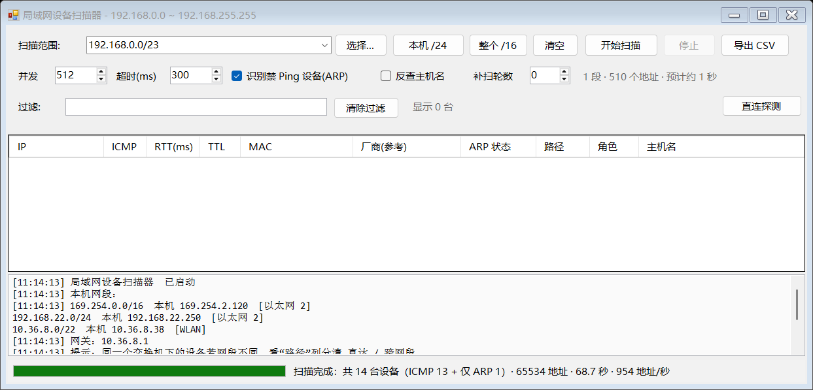

# LanScanner — 局域网设备扫描器

[](LICENSE)
[](https://github.com/dikt-dev/LanScanner/actions/workflows/build.yml)

仓库：https://github.com/dikt-dev/LanScanner

一次性把 `192.168.0.0/16` 这么大的网段扫完，找出所有能连通的子设备，列出 IP / MAC / 厂商 / ARP 状态 / 路由路径。
排查「网线插着的设备到底在哪个 IP」用它。



## 特点

- 单文件 exe，.NET Framework 4.x（Win7 SP1+ 自带运行时），免安装、免联网
- 并发 ICMP（默认 512 并发）+ 合并本机 ARP 邻居表 → 扫满 /16 约 **70 秒**，命中 **14 台**（本机实测基线）
- 禁 ping 的设备也能靠 ARP 发现；跨网段设备按本机路由表标出「直达 / 经网关」
- 范围可写 `/16`、`192.168.1.0/24`、`192.168.1.*`、`192.168.1.1-254`，也可用「选择…」勾选子网
- 列头排序、实时过滤（空格分隔多关键字 AND）、导出 CSV、右键复制/打开/ping
- 高 DPI 自适应；设置存 `%APPDATA%\LanScanner\settings.ini`

## 编译

```
build.cmd
```

或手动（先退出正在运行的 LanScanner.exe，否则报 CS0016）：

```
C:\Windows\Microsoft.NET\Framework64\v4.0.30319\csc.exe /nologo /target:winexe /codepage:65001 ^
  /optimize+ /out:LanScanner.exe /r:System.dll /r:System.Windows.Forms.dll /r:System.Drawing.dll ^
  Scan.cs Oui.cs Prefs.cs Ui.cs RangePicker.cs
```

## 使用

双击 `LanScanner.exe`，在「扫描范围」填网段，`Ctrl+Enter` 开始。完整说明见 [LanScanner.md](LanScanner.md)。

## 分发给别人

```
powershell -NoProfile -ExecutionPolicy Bypass -File make-release.ps1
```

生成 `release\LanScanner-v<日期>.zip`，对方解压后先跑 `1-unblock-first.cmd`（清「来自 Internet」标记）再跑 `2-start.cmd`。

正式发布版从 [Releases](https://github.com/dikt-dev/LanScanner/releases) 下载，那里放的是 CI 构建（并将在 SignPath 申请通过后）签名过的 exe。
原因与本项目的免费签名路线见 [LanScanner.md](LanScanner.md) 的「发给别人用」一节。

## 许可证

MIT，见 [LICENSE](LICENSE)。Copyright (c) 2026 dikt-dev
